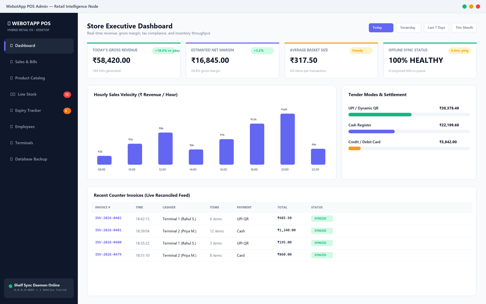
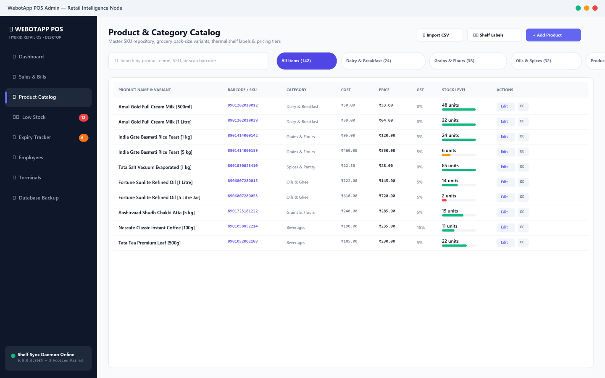
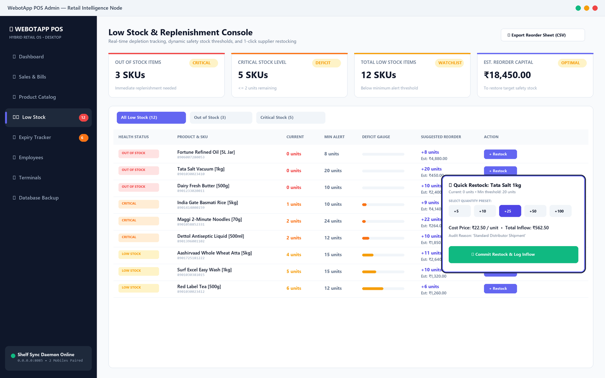
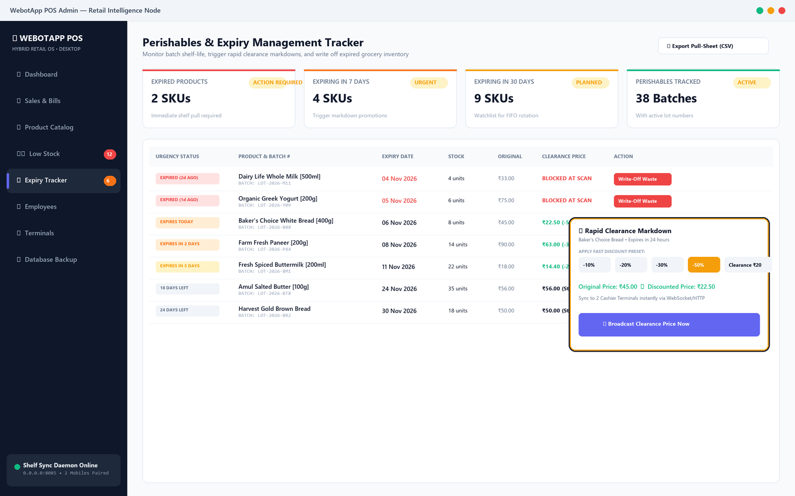
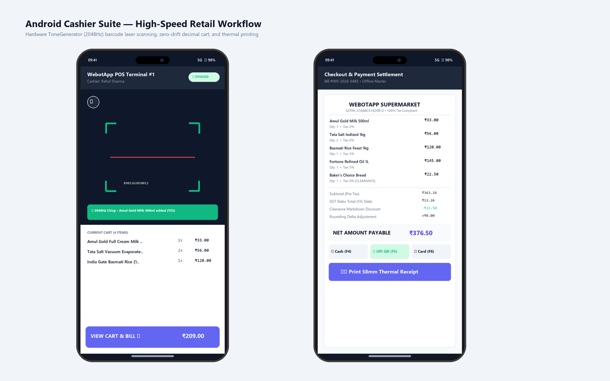

# WebotApp POS

An offline-first retail Point of Sale (POS) and inventory management ecosystem designed for grocery stores, supermarkets, and pharmacies.

WebotApp POS operates on a **hybrid local-first architecture**:
* A **Windows Desktop Admin Node** runs the master database, product catalog, sales analytics, and an embedded synchronization daemon.
* Multiple **Android Mobile Terminals** act as high-speed checkout registers with camera barcode scanning, retail confirmation audio, cart management, and thermal receipt printing.
* All transactions are processed 100% offline and reconcile seamlessly over the local network.

---

## Downloads

Official production binaries for **v1.0.0** are available on the [Releases page](https://github.com/webotapp-academy/webotapp-pos/releases/tag/v1.0.0):

* **Windows Installer**: [`WebotApp-POS-Setup-v1.0.0.exe`](https://github.com/webotapp-academy/webotapp-pos/releases/download/v1.0.0/WebotApp-POS-Setup-v1.0.0.exe) (Setup wizard, desktop shortcut, uninstaller)
* **Windows Portable**: [`WebotApp-POS-Windows-Portable-v1.0.0.zip`](https://github.com/webotapp-academy/webotapp-pos/releases/download/v1.0.0/WebotApp-POS-Windows-Portable-v1.0.0.zip) (Standalone folder)
* **Android Cashier App**: [`WebotApp-POS-Android-v1.0.0.apk`](https://github.com/webotapp-academy/webotapp-pos/releases/download/v1.0.0/WebotApp-POS-Android-v1.0.0.apk) (Android 7.0+)

---

## Product Showcase & Interface Tour

### 🖥️ Windows Desktop Admin Node

#### Executive Analytics & Real-Time Sync Dashboard
*Real-time monitoring of daily revenue velocity, gross profit margins, tender settlement split (UPI, Cash, Card), and live synced transaction feeds from cashier terminals.*


#### Master SKU Catalog & Pack-Size Variants
*Grocery master catalog management supporting linked pack-size variants (e.g., 500ml / 1L / 5L), barcode tagging, inventory levels, category filtering, and thermal shelf label generation.*


#### Low Stock Replenishment & Safety Stock Console
*Real-time depletion alerts, visual stock deficit gauges, 1-click supplier restocking with predefined quantity chips (`+5`, `+10`, `+25`, `+50`, `+100`), and direct CSV export for procurement reordering.*


#### Perishables Shelf Life & Expiry Management
*Automated expiry countdown alerts (`EXPIRED`, `EXPIRES TODAY`, `EXPIRES IN X DAYS`), rapid clearance markdown engine (-10% to -50% promotional broadcast), and recorded waste write-offs for damaged stock.*


---

### 📱 Android Mobile Cashier Suite

#### High-Speed Barcode Checkout & Digital Thermal Settlement
*Hardware `ToneGenerator` (2048Hz confirmation chirp) camera scanner with double-scan prevention, zero-drift decimal billing calculations, multi-tier GST breakdown, dynamic UPI QR payment settlement, and Bluetooth/USB 58mm thermal receipt printing.*


---

## Architecture

```
                      [ Local Store Network / Hotspot ]
                                     │
       ┌─────────────────────────────┴─────────────────────────────┐
       │                                                           │
       ▼                                                           ▼
[ Mobile Terminal 1 ]                                     [ Mobile Terminal 2 ]
  ├── Barcode Scanner Gun (ToneGenerator 2048Hz)            ├── Local Drift SQLite
  ├── Zero-Shift Cart & Tactile Keypad                      ├── Offline Sales Outbox
  └── Offline Sales Outbox                                  └── Instant Local Checkout
       │                                                           │
       └─────────────────────────────┬─────────────────────────────┘
                                     │ HTTP Sync (Port 8085)
                                     ▼
                     [ Windows Admin Desktop Node ]
                       ├── Master Drift SQLite Database
                       ├── Embedded Shelf Daemon (Auto-discovery & Pairing)
                       ├── Product Catalog & Pack-Size Variants
                       ├── Thermal Receipt & Shelf Label Generator
                       └── Executive Sales & Revenue Analytics
```

---

## Engineering Details

* **Zero-Drift Financial Math**: All currency, tax slabs, and line-item discounts use arbitrary-precision `Decimal` objects to prevent floating-point rounding errors (`0.1 + 0.2 != 0.3`).
* **Offline-First Resilience**: Mobile terminals queue transactions in a local SQLite outbox. If the desktop goes offline or the Wi-Fi drops, cashiers continue billing uninterrupted. Transactions automatically sync when the connection resumes.
* **Hardware-Grade Scanner Audio**: The mobile app calls Android's hardware `ToneGenerator` (2048Hz confirmation chirp, 120ms) via a native Kotlin MethodChannel, reproducing the exact tactile and auditory feel of a handheld supermarket scanner gun.
* **Double-Scan Guard**: Incorporates frame debouncing and in-flight mutex locks to prevent duplicate product additions when holding the camera over a barcode.
* **Thermal Printing & WhatsApp**: Generates deterministic 58mm and 80mm ESC/POS PDF receipts for Bluetooth/USB thermal printers and includes direct WhatsApp invoice sharing.

---

## Repository Structure

This project is organized as a Flutter/Dart monorepo:

```
├── apps/
│   ├── desktop/             # Windows desktop application (Store Admin Node)
│   └── mobile/              # Android mobile application (Cashier Terminal)
├── packages/
│   ├── billing_engine/      # Decimal arithmetic, discounts, and GST tax calculation
│   ├── database/            # Drift (SQLite) DAOs, tables, migrations, and backups
│   └── sync_protocol/       # Shelf HTTP server, pairing handshake, and sync queue
├── packaging/
│   └── windows/             # Inno Setup script for building the Windows installer
└── scripts/
    └── test_all.ps1         # Monorepo test runner across all 5 projects
```

---

## Getting Started

### Prerequisites

* [Flutter SDK](https://flutter.dev/docs/get-started/install) (3.24+ recommended)
* [Dart SDK](https://dart.dev/get-dart)
* Windows 10/11 with Visual Studio C++ Build Tools (for desktop build)
* Android Studio / Android SDK (for mobile build)
* Inno Setup 6 (optional, for compiling the Windows installer)

### Setup & Code Generation

Clone the repository and install dependencies across all packages:

```bash
git clone https://github.com/webotapp-academy/webotapp-pos.git
cd webotapp-pos

# Fetch dependencies for all packages and apps
cd packages/database && dart pub get && dart run build_runner build && cd ../..
cd packages/billing_engine && dart pub get && cd ../..
cd packages/sync_protocol && dart pub get && cd ../..
cd apps/desktop && flutter pub get && cd ../..
cd apps/mobile && flutter pub get && cd ../..
```

### Running the Apps Locally

**Windows Desktop Admin:**
```bash
cd apps/desktop
flutter run -d windows
```

**Android Mobile Cashier:**
```bash
cd apps/mobile
flutter run -d <your-device-id>
```

---

## Running Tests

Run the full automated test suite (131 tests across 5 projects):

```powershell
pwsh -File ./scripts/test_all.ps1
```

Or test individual modules:

```bash
# Test Billing Engine
cd packages/billing_engine && dart test

# Test SQLite Database & DAOs
cd packages/database && dart test

# Test Sync Protocol & Server
cd packages/sync_protocol && dart test

# Test Desktop Admin
cd apps/desktop && flutter test

# Test Mobile App
cd apps/mobile && flutter test
```

---

## Building Production Binaries

### Windows Installer (`.exe`)

1. Compile the Flutter release binary:
   ```bash
   cd apps/desktop
   flutter build windows --release
   ```
2. Compile the installer wizard with Inno Setup:
   ```powershell
   & "C:\Users\<user>\AppData\Local\Programs\Inno Setup 6\ISCC.exe" packaging/windows/inno_setup.iss
   ```
   The installer executable will be generated at `dist/WebotApp-POS-Setup-v1.0.0.exe`.

### Android APK (`.apk`)

```bash
cd apps/mobile
flutter build apk --release
```
The output APK will be generated at `apps/mobile/build/app/outputs/flutter-apk/app-release.apk`.

---

## Pairing & Local Sync Guide

1. Launch **WebotApp POS** on Windows.
2. In the navigation rail, navigate to **Terminals** (Port 8085 is active by default).
3. Open **WebotApp POS** on Android and tap **Pair Terminal**.
4. Scan the pairing QR code displayed on the desktop screen.
5. If running on a secured office router with AP Isolation enabled, run `allow_firewall_sync_port.bat` on the Windows PC as Administrator or connect both devices to the same mobile hotspot.

---

## License & Credits

Developed by the **WebotApp** team. Visit [webotapp.com](https://webotapp.com) for more information.
Licensed under the Apache 2.0 License.

